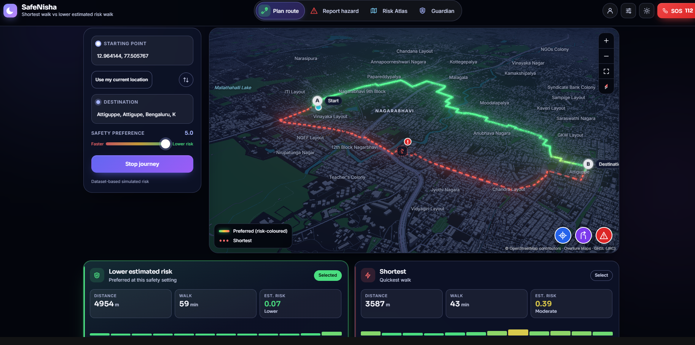
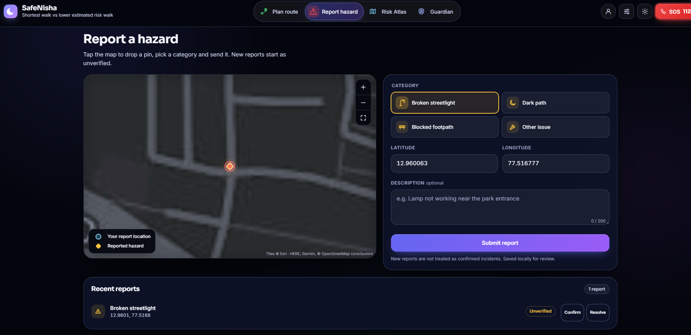
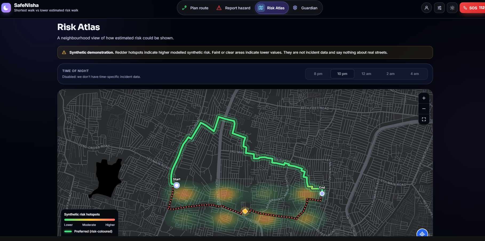
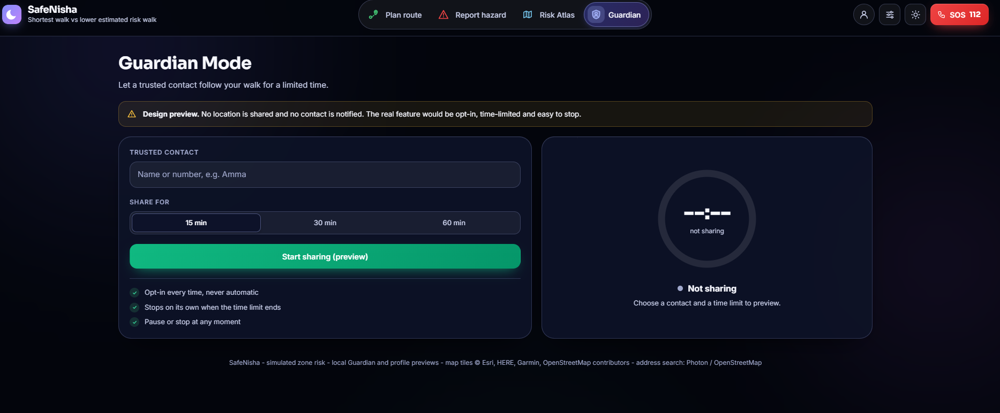

# SafeNisha - Adaptive Urban Safety & Risk-Aware Path Mapping

### Informed choices for everyday walks.

**Risk-aware pedestrian navigation with explainable route choices, community hazard reporting, and live journey rerouting.**

SafeNisha helps people compare the shortest available walking route with an alternative that balances distance and estimated risk. Instead of showing only a route line, it explains the trade-off through distance, walking time, local risk colours, and a Risk Atlas.

**Project status:** Working local prototype. Routing uses real walking paths; the risk demonstration uses explicitly labelled synthetic data.

**3D route planning** · **GPS-based rerouting** · **Saved user accounts** · **61 automated tests passing**

[Product tour](#product-tour) · [How it works](#how-the-risk-calculation-works) · [Run the app](#run-the-application) · [Judge walkthrough](#suggested-judge-walkthrough)

## Product tour

### 1. See the trade-off before you walk

Compare the shortest route with a route that gives estimated risk more influence, directly on a **3D Bengaluru city map**. Adjust the safety preference and inspect distance, walking time, and risk along the path. The same routing engine powers the 3D view and the route cards.



*In this captured demonstration, the preferred route is 4,954 m with a synthetic risk indicator of 0.07; the shortest is 3,587 m with an indicator of 0.39. The user can see the extra walking distance and choose the trade-off. These indicators are model scores, not probabilities of harm.*

### 2. Turn a reported problem into a routing decision

Pick the hazard point on the planner, then report a broken streetlight, dark path, blocked footpath, or another infrastructure issue. **Submitting the report returns to the planner and requests an avoidance route.** During a journey, explicit rerouting starts from a fresh GPS location. Reports remain visible with their review status.



*New reports start as unverified. A report can guide avoidance for its submitter without being presented as a confirmed incident for everyone.*

### 3. Understand the route in its neighbourhood

The **Risk Atlas** overlays the preferred and shortest routes on a smooth kernel-density heatmap. Its hotspots and the route scorer use the same synthetic risk field, connecting the visual explanation to the routing decision. Redder areas show higher model values; faint areas show lower values.



*The heatmap appears only in Risk Atlas. Its illustrative hotspots do not establish the actual safety of the streets shown.*

### 4. Design for support throughout the journey

**Guardian Mode previews our next step:** an opt-in, time-limited way for a trusted contact to follow a walk. The interface shows contact selection, a sharing duration, and clear controls for starting or stopping the session.



*Guardian Mode is currently a browser-local design preview. It does not share location or notify a contact.*

---

## The problem

Most navigation experiences make distance and travel time easy to compare. A pedestrian may also care about poor lighting, isolated stretches, reported obstructions, and incident patterns, especially when walking alone or after dark.

These concerns are difficult to turn into a practical decision: *Would a slightly longer walk avoid a higher-risk stretch?*

SafeNisha makes that trade-off visible and adjustable. It supports a more informed choice; it does not promise that any route is safe.

## Our approach

1. Find walkable routes between the selected endpoints.
2. Estimate exposure to incident, lighting, isolation, and hazard indicators along each path.
3. Search for additional walking alternatives around relevant modelled hotspots.
4. Rank the available paths using the user's distance-risk preference.
5. Show the shortest and preferred choices with clear, local risk information.
6. Recalculate when a hazard is submitted or a journey needs rerouting.

## What works today

| Feature | Implemented behaviour |
| --- | --- |
| **3D Plan map** | Explore the Bengaluru city model with buildings, roads, tilted camera controls, GPS, endpoint and hazard pins. Displays the existing backend routes and risk colours; routing calculations are unchanged. Report Hazard and Risk Atlas retain their 2D maps. |
| **Flexible endpoint selection** | Search addresses and place names, enter coordinates, or focus an entry field and select its point on the map. |
| **Nearby address suggestions** | Suggestions appear while typing and prioritize indexed matches within approximately 7 km of the current location or selected start. |
| **Shortest vs preferred routes** | Compare walking distance, estimated walking time, risk indicators, and risk bands along each route. |
| **Adjustable safety preference** | A slider changes the influence of estimated risk. Zero favours distance; higher settings give risk more influence. |
| **Risk-aware alternative search** | Request additional paths around intersecting synthetic hotspots, even when the initial router returns only one path. |
| **Risk-coloured roads** | Preferred-route segments show local model risk rather than using a single colour for the entire path. |
| **Risk Atlas** | View synthetic kernel-density hotspots with the current shortest and preferred routes. The heatmap appears only in the atlas. |
| **Current location** | Centre either map on GPS, or use the current location as the starting point. |
| **Journey tracking** | Update location while the page is open. Explicit rerouting during a journey uses a fresh GPS origin. |
| **Hazard reporting** | Click the warning icon, pick the hazard location, then complete the report page. The selected pin and earlier reports remain visible. |
| **Submit-and-reroute** | Submission saves the report, returns to the planner, and requests an avoidance route for the reporting user. Draft selections do not change routes. |
| **Persistent local reports** | SQLite stores reports and their review status. Local controls can confirm or resolve them. |
| **Accounts and saved profiles** | Register and sign in with email and password. SQLite persists profile details, trusted contacts and the default safety preference. Salted password hashes and revocable HttpOnly cookie sessions replace the browser-only preview. |
| **Responsive interface** | Desktop and mobile layouts, light/dark themes, and keyboard-accessible address suggestions. |

### Reporting and rerouting

The two map actions serve different purposes:

- **Report hazard:** Pick a location, describe the issue, and submit it. A new report remains **unverified**; avoiding it for the reporting user does not globally confirm it.
- **Reroute:** Recalculate around active reported hazards. Before a journey, use the selected start. During a journey, obtain a fresh GPS fix and route from that location. Show a U-turn marker when the new departure genuinely reverses the user's direction.

The report map includes saved report history, including resolved markers, independently of the planner's hazard visibility setting.

## How the risk calculation works

### 1. Model incident counts with exposure

The supplied dataset contains **192 synthetic observations**: eight placeholder zones across 24 months.

| Dataset property | Value |
| --- | --- |
| Observation unit | Zone and calendar month |
| Training period | 2024: 96 records |
| Evaluation period | 2025: 96 records |
| Model comparison | Poisson and Negative Binomial count models |
| Selection criterion | Training AIC |
| Evaluation | Held-out MAE and RMSE, compared with an exposure-based baseline |

Both models use previous incidents, lighting, infrastructure-report counts, and isolation. Pedestrian exposure enters as a **log offset**, allowing counts to be interpreted relative to activity rather than treating a busy area and a quiet area as directly comparable.

Negative Binomial was selected for this dataset, which contains extra variability beyond the Poisson assumption. The generator's `true_mean` values and held-out outcomes are excluded from fitting. Evaluation uses observed previous-month counts, so it is a one-step-ahead evaluation rather than a year-long forecast.

### 2. Build a continuous demonstration field

The JSON contains **no real coordinates or verified zone boundaries**. Its placeholder zones are positioned as illustrative anchors over the planning area.

Gaussian kernels turn their modelled incident rates, lighting deficiency, and isolation into a continuous field. The backend scorer and browser heatmap share the same kernel bandwidth, weights, and numeric calculation. Routes are sampled along their actual geometry; card bands summarize equal-distance portions of the path.

**Redder hotspots represent higher synthetic model values. They are not evidence that those real streets are dangerous.**

### 3. Combine the indicators

```text
Risk = 0.35 C + 0.30 L + 0.20 H + 0.10 I + 0.05 U
```

| Indicator | Meaning in the prototype |
| --- | --- |
| C | Normalized, exposure-adjusted modelled incident contribution |
| L | Lighting deficiency: higher values mean poorer lighting |
| H | Applicable confirmed reports or reports explicitly selected for avoidance |
| I | Isolation contribution |
| U | Uncertainty; kept at its maximum for the synthetic spatial demonstration |

These are configurable prototype weights, not statistically established measures of personal danger. The resulting score is an indicator, **not a probability**.

### 4. Balance distance and risk

```text
Route cost = distance in metres x (1 + safety preference x route risk)
```

The engine compares returned walking paths and bounded hotspot-bypass candidates. It uses exclusion polygons rather than arbitrary waypoints that could send users into unnecessary side-lane excursions. Selected endpoints remain protected during candidate generation.

This is a bounded search over available walking alternatives, not a guarantee of the globally lowest-risk route. A route may remain unchanged if alternatives are unavailable or do not improve the selected trade-off.

## Evidence from the working prototype

In a verified walking-route test at safety preference **5**, the app compared six paths:

| Choice | Distance | Synthetic model risk |
| --- | ---: | ---: |
| Shortest | 3,855 m | 0.277 |
| Preferred | 3,878 m | 0.191 |

The preferred option added **23 metres** while reducing the model's route-exposure indicator. This demonstrates the routing behaviour; it does not establish a reduction in real-world danger.

**Validation completed:**

- **61 automated tests passing**, covering accounts, session expiry, profile isolation, password verification, model validation, data leakage, scoring, risk alternatives, hazard handling, GPS-origin requirements, and address search.
- Chrome checks for the complete planning/reporting/rerouting flow on desktop and mobile.
- A regression check on the route above confirms that preference zero selects the shortest path and preference five selects a distinct lower-risk alternative.
- Python and browser risk calculations agree to `1e-10` at the tested anchor centres.

See [test results](docs/test_results.md) for the recorded checks.

## Architecture

```text
Browser: HTML / CSS / JavaScript
    |
    | Local JSON API
    v
Python application server (web_app.py)
    |
    +-- Walking router client ------ OSRM foot routing / Valhalla fallback
    +-- Address search ------------- Photon / OpenStreetMap-derived index
    +-- Incident models ------------ Synthetic JSON dataset
    +-- Gaussian risk field -------- Route scoring and Risk Atlas
    +-- Alternative search --------- Hotspot and hazard avoidance
    +-- Hazard service ------------- Local SQLite database
    +-- Account service ------------ Password verification, sessions and saved profiles
```

| Technology | Purpose |
| --- | --- |
| HTML, CSS, JavaScript | Standalone frontend, responsive layouts, theme, map interactions |
| Three.js / WebGL 2 | Plan-page 3D city rendering, streamed local map tiles, and route overlays |
| SVG and canvas | Road geometry, markers, local risk colours, kernel-density rendering |
| Python standard-library HTTP server | Serve the frontend and local API |
| NumPy | Fit the exposure-adjusted count models |
| SQLite | Persist hazard reports and review status |
| OSRM / Valhalla | Obtain actual walking paths and avoidance candidates |
| Photon | Cached, rate-limited address and place search |
| Esri Canvas basemap | Background tiles for Report Hazard, Risk Atlas, and the 2D Plan fallback |
| Streamlit / Folium | Earlier prototype retained for development reference |

### Key files

```text
web_app.py                    Main application entry point and API
core/
  journey_service.py          Planning orchestration and route packaging
  osm_router.py               Walking-service client and fallback
  risk_alternatives.py        Synthetic-hotspot bypass candidates
  hazard_detour.py            Hazard avoidance and junction handling
  incident_model.py           Poisson / Negative Binomial fitting and evaluation
  synthetic_routing.py        Synthetic anchors and shared Gaussian field
  route_scoring.py            Route factors and distance-risk ranking
  risk_engine.py              Indicator weights and validation
  geocoding.py                Nearby address lookup and caching
  accounts.py                 Accounts, password hashes, sessions and saved profiles
hazards/                      Report validation, persistence and review
ui/web/                       Integrated standalone frontend
  js/map3d.js                 Display adapter for the Plan page; no routing calculations
  map3d/                     Vendored 3D renderer, licences, and Bengaluru map assets
data/                        Synthetic dataset and provenance notes
tests/                       Automated and browser integration checks
```

## Run the application

Use a recent Python 3 installation compatible with the packages in `requirements.txt`.

```powershell
python -m pip install -r requirements.txt
python web_app.py
```

Open **http://127.0.0.1:8502**.

- Keep the Python server running; opening the HTML file directly does not connect the API.
- Internet access is required for address lookup, walking-route requests, and the 2D basemaps. The 3D Bengaluru city assets are served locally.
- The 3D Plan map needs WebGL 2 and a browser supporting `DecompressionStream`; the existing 2D map is used if 3D cannot load. Drag to pan, right-drag to tilt or rotate, and use the zoom, fit, or north controls.
- Allow browser location access to use GPS features. Map selection and coordinate entry remain available without it.
- Choose another port if needed: `python web_app.py --port 8504`.

The earlier Streamlit interface can be run separately with:

```powershell
python -m streamlit run app.py --server.port 8501
```

### Run the tests

```powershell
python -m unittest discover -s tests
```

Browser checks require installed Google Chrome and the optional test dependency:

```powershell
python -m pip install playwright
```

Use a separate server and database so test reports do not enter the main report history:

```powershell
python web_app.py --port 8503 --database data/integration_test.sqlite3
```

Then, in a second terminal:

```powershell
python tests/web_integration_check.py
python tests/exact_route_browser_check.py
python tests/profile_browser_check.py
```

## Suggested judge walkthrough

1. **Plan a walk.** Search two places, or focus each endpoint field and select it on the map. Routes appear automatically.
2. **Compare the trade-off.** Move safety preference from zero toward five. Inspect the route cards, local road colours, and number of candidates compared.
3. **Open Risk Atlas.** Compare the same paths against the synthetic hotspots. Explain that the map and scorer use one shared numeric field.
4. **Report a problem.** Click the warning icon, pick a point on the route, and submit a hazard. Show the pin and saved reports before submission, then the updated route afterward.
5. **Demonstrate live rerouting.** Start a journey with GPS permission. The separate reroute action uses the current fix, rather than a previous route origin.
6. **Show responsive design.** Switch theme and resize to a mobile viewport.

Public routing and geocoding services can be unavailable. A failed request should be retried or demonstrated with a nearby walkable endpoint; a straight line must not be presented as a real walking route.

## Prototype boundaries and next steps

| Working now | Next stage |
| --- | --- |
| Synthetic, exposure-adjusted incident modelling | Licensed, geographically appropriate real observations and independent validation |
| Illustrative Gaussian risk anchors | Verified geographic mapping and appropriate spatial resolution |
| Bounded walking-alternative search | Broader network-level risk-aware optimization and stronger service reliability |
| Local report persistence and review | Authenticated moderation, abuse prevention and expiry workflows |
| Foreground browser GPS | Tested production journey handling and explicit background-tracking design |
| SQLite-backed accounts, profiles and trusted contacts | Email verification and password recovery |
| Guardian design preview | Verified contacts and a consent-based sharing service |

**Profile sign-in now uses backend authentication. Passwords are stored as salted PBKDF2-SHA256 hashes; revocable sessions expire after seven days, and unsuccessful login attempts are rate limited. Email addresses and trusted contacts are not verified. Guardian Mode does not share location or notify contacts. SOS opens the phone dialer where supported; it does not automatically call or send an alert.**

The server is intended for localhost use. Review controls are not authenticated. Route coordinates are sent to the configured walking service, address queries to the geocoder, and basemap requests to the tile provider. There is no production emergency-response integration.

## Project notes

- [Data provenance and synthetic-data limits](data/incident_data_sources.md)
- [Recorded validation results](docs/test_results.md)
- Active interface: `ui/web/`, integrated from the team's supplied frontend design in `ui_for_integration/`.

**SafeNisha's goal is to make the distance-risk trade-off understandable and actionable, while keeping the evidence and limitations visible.**
